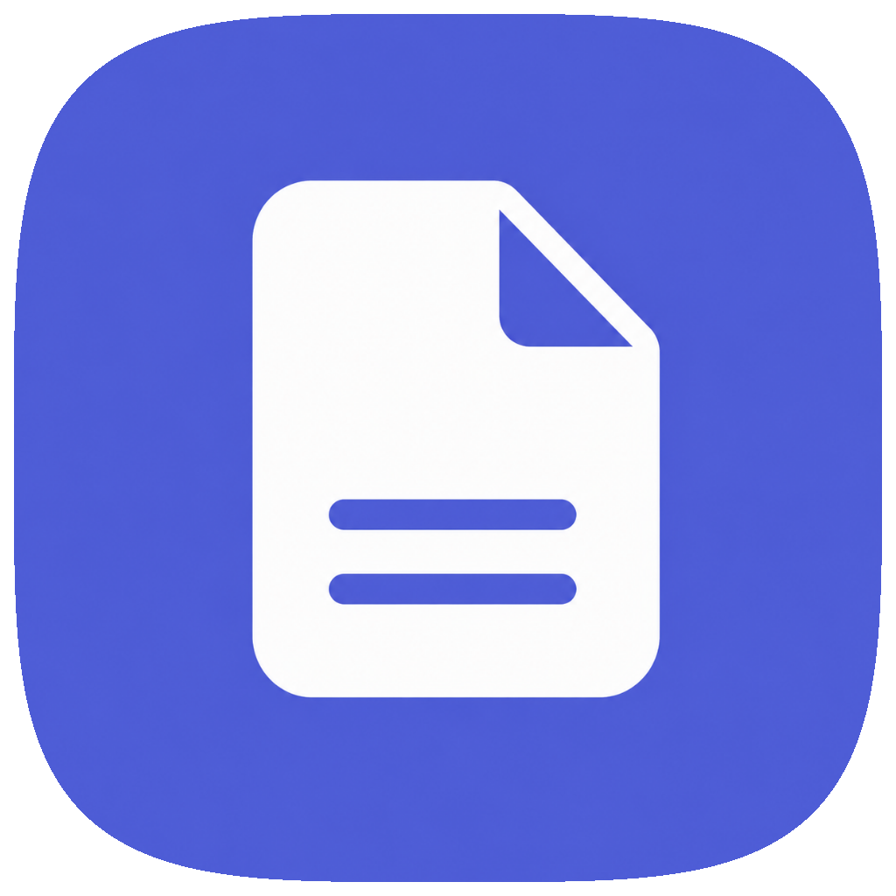
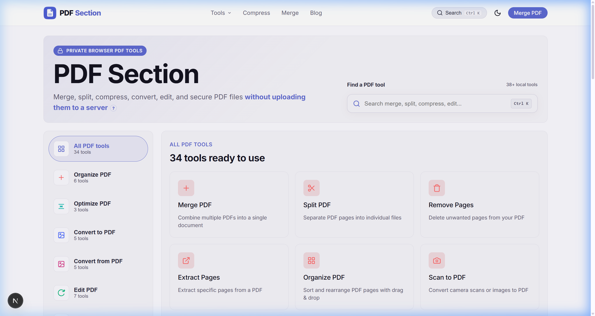

<div align="center">

  

  # PDF Section
  **100% Private, Free Online Browser PDF Tools & Utilities**

  [](https://nextjs.org/)
  [](https://reactjs.org/)
  [](https://pdfsection.com/privacy)
  [](LICENSE)

  <p align="center">
    Every tool you need to work with PDFs in one place. Merge, split, compress, convert, edit, sign, and secure documents without uploading them to remote servers. 100% free, private, and runs entirely in your browser tab.
  </p>

  [**Explore Live Workspace →**](https://pdfsection.com)

</div>

---

## 🖼️ Application Workspace Preview

<div align="center">
  
</div>

---

## ✨ Key Features

- **🛡️ 100% Private & Serverless**: Files never touch remote servers. All PDF parsing, page manipulation, compilation, and rendering occur locally in your browser memory tab via WebAssembly and `pdf-lib`.
- **⚡ 38+ Local Browser PDF Tools**:
  - **Organize**: Merge PDF, Split PDF, Remove Pages, Extract Pages, Rotate PDF, Organize Pages.
  - **Optimize & Compress**: Lossless and Raster compression with **Smart Fallback Protection** (ensuring compression never increases file size).
  - **Convert**: PDF to Word, Word to PDF, PDF to JPG, JPG to PDF, PDF to Excel, Excel to PDF, PowerPoint to PDF, PDF to Markdown, PDF to PDF/A.
  - **Security & Edit**: Sign PDF, Add Watermark, Add Page Numbers, Bates Numbering, Protect/Encrypt PDF, Unlock PDF, OCR Searchable PDF, Crop PDF, Compare PDFs.
- **🔍 Search Engine Optimized (SEO Ready)**:
  - Server-Side Rendered (SSR) metadata, canonical links (`<link rel="canonical">`), character-length-optimized titles (50–60 chars) and meta descriptions (150–160 chars).
  - Schema.org JSON-LD (`WebApplication`, `WebSite` Sitelinks SearchBox, `Organization`, `BlogPosting`, `FAQPage`, `SoftwareApplication` with star ratings).
  - 100% complete dynamic `sitemap.xml` and `robots.txt`.
- **🔒 Enterprise Security Headers**: Pre-configured HTTP response headers (`X-Frame-Options: DENY`, `X-Content-Type-Options: nosniff`, `HSTS`, `Referrer-Policy`, `Permissions-Policy`).
- **🎨 Modern Dark & Light Mode UI**: Responsive workspace built with CSS tokens, subtle glassmorphism, fluid typography, and instant keyboard shortcuts (`Ctrl + K` tool command palette).

---

## 🛠️ Technology Stack

- **Framework**: [Next.js 16 (App Router)](https://nextjs.org/) & [React 19](https://reactjs.org/)
- **PDF Core Engines**: [`pdf-lib`](https://github.com/Hopding/pdf-lib), [`pdfjs-dist`](https://mozilla.github.io/pdf.js/), [`@pdfsmaller/pdf-encrypt`](https://www.npmjs.com/package/@pdfsmaller/pdf-encrypt), [`jspdf`](https://github.com/parallax/jsPDF)
- **OCR Engine**: [`tesseract.js`](https://github.com/naptha/tesseract.js)
- **Document Processing**: `mammoth` (DOCX to HTML), `docx-preview`, `html2canvas`, `jszip`
- **Analytics & Performance**: `@vercel/analytics`, `@next/third-parties/google`
- **Styling & Icons**: Custom CSS Design Tokens, JetBrains Mono & Inter typography

---

## 🚀 Getting Started

### Prerequisites

Ensure you have **Node.js 18.0.0+** and **npm** installed.

### Installation

1. **Clone the repository**:
   ```bash
   git clone https://github.com/muzammilkarimi/pdfsection.git
   cd pdfsection
   ```

2. **Install dependencies**:
   ```bash
   npm install
   ```

3. **Run the development server**:
   ```bash
   npm run dev
   ```

4. **Open in browser**:
   Navigate to [http://localhost:3030](http://localhost:3030) (or default port `3000`).

---

## 🏗️ Production Build & Verification

To test static prerendering, metadata generation, and bundle optimization:

```bash
npm run build
npm run start
```

Outputs 102/102 prerendered static pages with zero errors.

---

## 👨‍💻 Founder & Community

PDF Section is built and maintained by **Muzammil Ahmad Karimi** (IIT Patna alumnus) to make document utilities fast, free, and genuinely private for students, developers, creators, and professionals worldwide.

- **Twitter / X**: [@muzammilkarimi](https://x.com/muzammilkarimi)
- **LinkedIn**: [Muzammil A Karimi](https://www.linkedin.com/in/makarimi01/)
- **GitHub**: [@muzammilkarimi](https://github.com/muzammilkarimi)

---

## 📄 License

Distributed under the MIT License. See `LICENSE` for more details.
